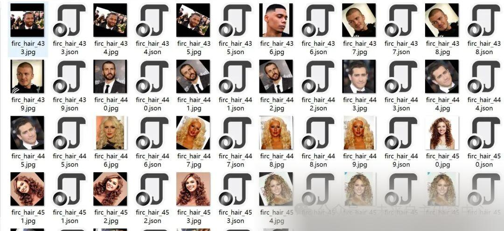
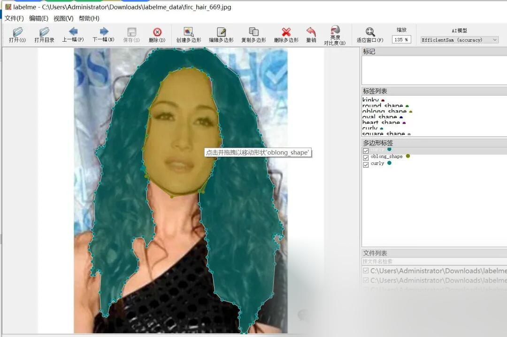

# Hair segmentation dataset in labelme format with 3970 images across 7 categories

Dataset 1/3 is the original image, while the rest are enhanced images.

Dataset format: labelme format (without mask files, only including jpg images and corresponding json files)

Number of images (number of jpg files): 3970

Number of annotations (json file count): 3970

Label category count: 9

Label category names: ["kinky", "heart_shape", "curly", "round_shape", "square_shape", "oval_shape", "oblong_shape", "straight", "wavy"]

Number of boxes labeled in each category:

kinky count = 1016

heart_shape count = 855

curly count = 789

round_shape count = 778

square_shape count = 713

oval_shape count = 801

oblong_shape count = 705

straight count = 1337

wavy count = 909

Using labeling tool: labelme=5.5.0

Annotation rules: Draw polygons around the categories.

Important Notice: The dataset can be opened and edited using LabelMe. For JSON datasets, one must convert them into mask or Yolo formats for semantic segmentation or instance segmentation.

Special : This dataset does not guarantee the accuracy or precision of the trained models or weight files. The dataset is provided with accurate and reasonable annotations only.

Image Preview:

Annotation example:

## Payment

Here is a pay link on Stripe ( https://buy.stripe.com/3cs8yP7sY87d0vu9AB ). Please contact me lonlonago@foxmail.com after funding $89, and I will send you a complete data files , thank you!

